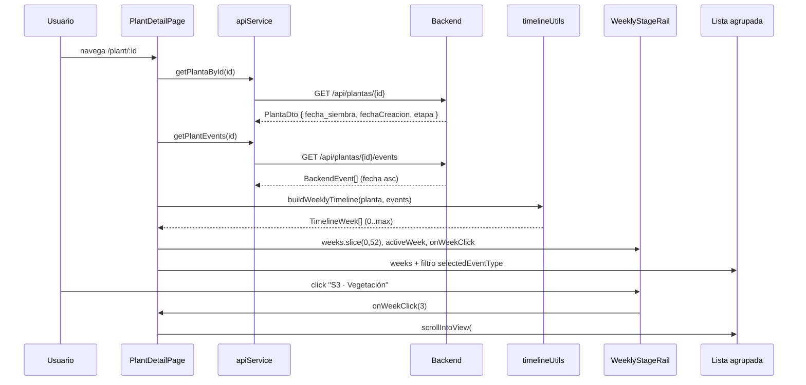

# Design: Timeline semanal de planta

**Decisión en una línea**: `fecha_siembra` se persiste en `plantas` (default en `@PrePersist`), viaja por HTTP con `@JsonProperty("fecha_siembra")`, y el timeline se calcula en un util puro de frontend (`buildWeeklyTimeline`) que alimenta un riel de chips (máx. 52) y una lista agrupada por semana.

## 1. Enfoque técnico

Backend: campo nuevo + mapeo bidireccional + default de persistencia, sin migración versionada. Frontend: una sola definición Zod del campo, dos formularios que la consumen, un módulo compartido de etapas y un util determinista. La página `/plant/:id` ya descarga `planta` y `events`; no se agrega endpoint.



## 2. Modelo de datos

`Planta.java`, después de `fechaFin` (línea 73):

```java
@Column(name = "fecha_siembra")
@DateTimeFormat(iso = DateTimeFormat.ISO.DATE)
@JsonFormat(shape = JsonFormat.Shape.STRING, pattern = "yyyy-MM-dd")
private LocalDate fechaSiembra;

@PrePersist
void applyDefaultFechaSiembra() {
    if (fechaSiembra == null) fechaSiembra = LocalDate.now();
}
```

- Columna: `fecha_siembra date`, **nullable**. Hibernate (`ddl-auto=update`) emite `alter table if exists plantas add column fecha_siembra date;`.
- `@PrePersist` corre solo en INSERT; cubre las 3 altas (incluida la masiva de `ZonaGridModal`, que no envía el campo). No se usa `@PreUpdate`: un update parcial con null no debe tocar el valor.
- `fechaCreacion` sigue con `@CreationTimestamp`; no se deriva de la siembra.
- Rollback: `ALTER TABLE plantas DROP COLUMN IF EXISTS fecha_siembra;`
- Backfill opcional (filas previas quedan NULL y el frontend cae a `fechaCreacion`): `UPDATE plantas SET fecha_siembra = fecha_creacion WHERE fecha_siembra IS NULL;`

`DtoMapper.java` (644 líneas):

- `plantaToPlantaDto` (tras línea 128): `plantaDto.setFechaSiembra(planta.getFechaSiembra());`
- `plantaDtoToPlanta` (tras línea 174): `if (plantaDto.getFechaSiembra() != null) planta.setFechaSiembra(plantaDto.getFechaSiembra());`
- **Eliminar la línea 170** `planta.setFechaCreacion(...)`. Es inútil en INSERT (`@CreationTimestamp` manda) y en UPDATE el DTO de `FormularioPlanta` no trae `fechaCreacion`, así que hoy escribiría `null` y borraría la columna. Sin esa línea, `fechaCreacion` queda server-managed de verdad.

## 3. Contrato de API y naming

Mecanismo: `@JsonProperty("fecha_siembra")` sobre el campo de `PlantaDto`.

```java
@JsonProperty("fecha_siembra")
@JsonFormat(shape = JsonFormat.Shape.STRING, pattern = "yyyy-MM-dd")
@DateTimeFormat(iso = DateTimeFormat.ISO.DATE)
@PastOrPresent(message = "La fecha de siembra no puede ser futura")
private LocalDate fechaSiembra;
```

`PlantaDto` completo: `id`, `userId`, `nombre`, `isPublic`, `etapa`, `salaId`, `produccion`, `fechaCreacion`, `fechaFin`, **`fecha_siembra`**, `eventIds`, `cepaId`, `zonaId`, `zonaNombre`, `columnaEnZona`, `filaEnZona`, `ubicacion`, `imagenUrl`, `favoriteCount`, `sala`, `cepaDto`.

Request `POST /api/plantas` (201):

```json
{
  "nombre": "GEL-005", "etapa": "VEGETACION", "fecha_siembra": "2026-09-01",
  "salaId": 3, "cepaId": 7, "produccion": 0, "isPublic": false, "ubicacion": null
}
```

Response (recorte): `{"id":42, ..., "fecha_siembra":"2026-09-01", "fechaCreacion":"2026-10-02", ...}`. `PUT /api/plantas/{id}` con el mismo body: valor no-null actualiza; ausente/null conserva. `fechaCreacion` en el request se ignora. Errores: fecha futura o formato inválido ⇒ 400 (Bean Validation / `HttpMessageNotReadableException`). `@AssertTrue @JsonIgnore isFechaSiembraValida()` rechaza `< 1900-01-01` (SHOULD de la spec) sin exponer un campo extra.

Impacto Zod (fuente única):

- `DTOSchemas.ts`: exportar `fechaSiembraSchema = z.string().min(1).regex(/^\d{4}-\d{2}-\d{2}$/)` y `fechaSiembraResponseSchema = fechaSiembraSchema.nullable().optional()`. Agregar `fecha_siembra: fechaSiembraResponseSchema` a `PlantaDtoSchema`.
- `NewPlantForm.tsx`: línea 39 pasa a `fecha_siembra: fechaSiembraSchema` (import); se elimina la definición local. Línea 202 pasa a `fecha_siembra: data.fecha_siembra` (hoy asigna la siembra a `fechaCreacion`).
- `FormularioPlanta.tsx`: `fechaSiembra: fechaSiembraSchema.optional()`, default `initialData?.fecha_siembra || ''`, payload `fecha_siembra: data.fechaSiembra || null`.

## 4. Contrato de cálculo

`buildWeeklyTimeline` normaliza por string para evitar zonas horarias: `toUtcDay(iso) = Date.UTC(y, m-1, d)` sobre `iso.slice(0,10)`; `diffDays = (toUtcDay(evento) - toUtcDay(ancla)) / 86_400_000`.

```
anchor   = planta.fecha_siembra ?? planta.fechaCreacion
current  = max(0, floor(diffDays(hoy, anchor) / 7))
maxWeek  = max(current, max(floor(diffDays(e.fecha, anchor)/7)) de los eventos)
changes  = STAGE_CHANGE con nuevaEtapa, ordenados por (fecha, id) asc
base     = changes[0]?.etapaAnterior ?? planta.etapa
week0Label = WEEK_ZERO_LABELS[base] ?? getEtapaLabel(base)   // GERMINACION→Semilla, PLANTIN→Esqueje

para n en 0..maxWeek:
  etapa = (n === 0) ? base
        : (último change con clamp(week(change), 0..) <= n)?.nuevaEtapa ?? base
  label = (n === 0) ? week0Label : getEtapaLabel(etapa)
  eventos = eventos cuyo clamp(week(evento), 0..maxWeek) === n
  hasPreSowingEvents = algún diffDays(evento, anchor) < 0
```

`week(x) = floor(diffDays(x, anchor)/7)`; `start = anchor + 7n`; `end = anchor + 7n + 6` inclusive. La semana 0 **siempre** usa `base` (aun si hay un `STAGE_CHANGE` dentro de la semana 0), porque la spec lo exige. La semana 0 se etiqueta Semilla/Esqueje; semanas ≥1 usan `ETAPA_LABELS`.

| Caso | Salida esperada |
|---|---|
| Sin eventos, siembra hoy | `[semana 0]`, etapa cruda de `planta.etapa` |
| Sin eventos, siembra hace 20 días | semanas `0..2`, todas con `base` |
| Evento el día de siembra | semana 0; si es `STAGE_CHANGE`, la etapa sigue siendo `base` |
| Evento en `sow+6` / `sow+7` | semana 0 / semana 1 |
| `STAGE_CHANGE` en `sow+14` (borde) | semanas 0-1 `base`; semana 2+ `nuevaEtapa` |
| Evento 10 días antes de la siembra | semana 0, `hasPreSowingEvents=true`, no se descarta |
| Planta de 60 semanas | cálculo devuelve `0..60`; el riel muestra 52 chips (`0..51`), la lista conserva la 60 |
| Dos `STAGE_CHANGE` en semana 3 | gana el de `fecha` mayor (desempate `id`) y se propaga |

## 5. Módulos frontend

`lib/etapas.ts` (nuevo, ~40 líneas):

```ts
export const ETAPA_COLORS = { GERMINACION: "...", PLANTIN: "...", VEGETACION: "...", FLORACION: "...", COSECHADA: "..." } as const;
export type Etapa = keyof typeof ETAPA_COLORS;
export const ETAPA_LABELS: Record<Etapa, string> = { ... };
export const WEEK_ZERO_LABELS: Partial<Record<Etapa, string>> = { GERMINACION: "Semilla", PLANTIN: "Esqueje" };
export function getEtapaColor(etapa: string): string;
export function getEtapaLabel(etapa: string): string;
```

`utils/timelineUtils.ts` (reescrito; se borra la línea 44 falsa y `differenceInWeeks`):

```ts
export const TIMELINE_MAX_RAIL_WEEKS = 52;

export interface TimelineWeek {
  weekNumber: number;        // 0-indexed
  startDate: string;         // yyyy-MM-dd
  endDate: string;           // yyyy-MM-dd, inclusivo
  startLabel: string;        // "12 mar"
  endLabel: string;
  etapa: Etapa;              // color
  label: string;             // texto (Semilla/Esqueje en semana 0)
  events: BackendEvent[];
  hasEvents: boolean;
  hasPreSowingEvents: boolean;
}

export function calculateCurrentWeek(fechaSiembra: string, today?: Date): number;
export function buildWeeklyTimeline(
  planta: Pick<PlantaDto, "fecha_siembra" | "fechaCreacion" | "etapa">,
  events: BackendEvent[],
): TimelineWeek[];
```

`PlantDetailPage` calcula una vez con **todos** los eventos (la etapa no debe depender del filtro) y filtra solo al renderizar cada semana. Así un filtro de "Riego" no borra los `STAGE_CHANGE` del cálculo y las semanas vacías siguen existiendo como destino de scroll.

`WeeklyStageRail.tsx` (nuevo, ~70 líneas):

```ts
interface WeeklyStageRailProps {
  weeks: TimelineWeek[];
  activeWeek: number | null;
  onWeekClick: (weekNumber: number) => void;
}
```

Renderiza `weeks.slice(0, TIMELINE_MAX_RAIL_WEEKS)` como `<button type="button">` en `nav aria-label="Semanas de la planta"` con `flex gap-2 overflow-x-auto pb-2 snap-x`. Cada chip: `<span>S{n} · {label}</span>`, `aria-label="Semana n, etapa label"`, `aria-current`, clases `getEtapaColor(etapa)`, `opacity-50 border-dashed` si `!hasEvents`, `ring-1 ring-orange-400` si `COSECHADA`, `ring-2 ring-primary` si activo. El texto de etapa es siempre visible: el color nunca es el único portador.

Lista agrupada (inline en `PlantDetailPage`, sin componente nuevo): por cada semana, `<section id={"week-group-"+n} className="scroll-mt-24 space-y-3">` con header `Semana {n} · {label}` + rango `{startLabel} – {endLabel}` + badge "Antes de la siembra" si aplica; eventos con `EventCard`; si el filtro deja la semana sin eventos, `<p>Sin eventos</p>` (el ancla existe igual). El banner "No hay eventos…" actual pasa a mostrarse arriba, sin reemplazar los grupos.

## 6. Archivos y puntos de inserción

| Archivo | Acción | Detalle |
|---|---|---|
| `backend/.../entities/Planta.java` | Modificar | campo tras línea 73; `@PrePersist` antes del cierre (84) |
| `backend/.../dto/PlantaDto.java` | Modificar | campo tras línea 46 |
| `backend/.../utils/DtoMapper.java` | Modificar | +2 líneas; borrar línea 170 |
| `backend/.../repository/PlantaRepositoryTest.java` | Modificar | persistencia + default |
| `backend/.../utils/DtoMapperTest.java` | Modificar | round-trip + no-wipe |
| `backend/.../controller/PlantaControllerTest.java` | Crear | wire key + 400 (patrón `ZonaControllerTest`) |
| `frontend/src/schemas/DTOSchemas.ts` | Modificar | export del campo + `fecha_siembra` en `PlantaDtoSchema` |
| `frontend/src/components/forms/NewPlantForm.tsx` | Modificar | líneas 39, 86, 202, 361 (361 ya existe) |
| `frontend/src/components/forms/FormularioPlanta.tsx` | Modificar | schema 21, default 64, payload 78, input junto a `fechaFin` (225-231) |
| `frontend/src/lib/etapas.ts` | Crear | colores/etiquetas compartidos |
| `frontend/src/utils/timelineUtils.ts` | Reescribir | API de §5; borrar línea 44 |
| `frontend/src/components/plants/PlantListView.tsx` | Modificar | borrar 11-17; importar `getEtapaColor` (uso en 65) |
| `frontend/src/components/plants/PlantProfile.tsx` | Modificar | borrar 19-25; importar `getEtapaLabel` (uso en 36) |
| `frontend/src/components/plants/WeeklyStageRail.tsx` | Crear | riel de chips |
| `frontend/src/pages/PlantDetailPage.tsx` | Modificar | imports 18-19; estado tras 30; `useMemo` tras 60; riel entre 116 y 118; reemplazar 129-153 conservando 126-128 |

`ZonaGridModal.tsx` **no cambia**: el campo es opcional y el default es server-side.

## 7. Decisiones de arquitectura

| Decisión | Opciones | Elección y rationale |
|---|---|---|
| Dónde calcular | Frontend vs endpoint backend | **Frontend**. Un consumidor, `planta`+`events` ya descargados, sin duplicar rutas público/privado. Costo: sin runner → funciones puras + casos dorados. Migrar a backend con el segundo consumidor. |
| Naming del wire | `@JsonProperty` vs naming strategy global vs renombrar a camelCase | **`@JsonProperty("fecha_siembra")`**. La spec exige snake_case; la strategy global rompería todos los DTOs y Zod; renombrar viola la spec. Ya hay precedente (`isPublic`) en el mismo DTO. |
| Default de siembra | `@PrePersist` vs default en DTO/servicio | **`@PrePersist`**. Cubre las 3 altas sin tocar la masiva y también cualquier save directo (tests). Un default de DTO se saltea fuera del controller. |
| Etapas compartidas | `lib/etapas.ts` vs constantes inline | **Módulo compartido**. Tres consumidores (riel, `PlantProfile`, `PlantListView`); una paleta evita divergencia. |
| UI | Solo riel vs solo lista vs ambos | **Ambos**. Riel = acceso rápido; lista = detalle y destino de scroll. |
| Tope 52 | En cálculo vs en riel | **En riel**. La spec exige que los eventos posteriores a la semana 51 sigan visibles en la lista; el cálculo no se recorta. |
| Mapper `fechaCreacion` | Conservar línea 170 vs borrarla | **Borrar**. En update el DTO no la envía y hoy escribiría null; borrarla asegura server-managed. |
| Lista agrupada | Componente nuevo vs inline | **Inline en la página**. Mantiene el conteo de archivos y el slice bajo presupuesto. |

## 8. Testing

| Capa | Qué | Cómo |
|---|---|---|
| Backend repo | valor explícito persiste; null ⇒ hoy; flush+clear+find | `PlantaRepositoryTest` con `TestEntityManager` |
| Backend mapper | round-trip; update con null conserva; update no pisa `fechaCreacion` | `DtoMapperTest`, `@Nested` |
| Backend HTTP | request sin campo ⇒ default; futuro/formato inválido ⇒ 400; respuesta con clave `fecha_siembra`; PUT sin campo conserva | `PlantaControllerTest` (`@SpringBootTest`, `MockMvc`, `@WithMockUser`) |
| Frontend | 8 casos dorados de §4 | Sin runner: validación manual con datos sembrados + `console.table` temporal en dev, y `npm run build` para tipos. Se elimina el `console.table` antes del PR |

Vitest se difiere: instalar runner + config + CI es alcance propio, hay un solo consumidor y la lógica es pura. Se incorporará cuando exista un segundo consumidor o cuando el cálculo se mueva al backend.

## 9. PRs encadenados

| Slice | Archivos | Líneas |
|---|---|---|
| 1 | `Planta.java`, `PlantaDto.java`, `DtoMapper.java`, `PlantaRepositoryTest`, `DtoMapperTest`, `PlantaControllerTest` (nuevo), `DTOSchemas.ts` | 120-150 |
| 2 | `NewPlantForm.tsx`, `FormularioPlanta.tsx` | **40-60** (no 70-100: el input de fecha ya existe en `NewPlantForm:361`) |
| 3 | `lib/etapas.ts` (nuevo), `timelineUtils.ts`, `PlantListView.tsx`, `PlantProfile.tsx` | 120-150 |
| 4 | `WeeklyStageRail.tsx` (nuevo), `PlantDetailPage.tsx` | 140-180 |

Cada slice es revertible por separado. El slice 1 puede desplegarse antes del 2 sin romper el formulario viejo: el `fechaCreacion` que envía hoy ya era ignorado por `@CreationTimestamp`.

## 10. Riesgos

| Riesgo | Mitigación |
|---|---|
| `@JsonProperty` no aplicado por la combinación Lombok/Jackson | Test HTTP que asserta la clave `fecha_siembra` en request y response |
| Backfill no ejecutado: filas viejas con `fecha_siembra` NULL | Frontend usa `fecha_siembra ?? fechaCreacion`; backfill idempotente documentado |
| Update parcial pisa `fechaSiembra` | Set solo si no-null + test dedicado |
| Frontera de semana / DST | Aritmética en días UTC por string; prohibido `differenceInWeeks` |
| Eventos antes de la siembra | Clamp a semana 0 + `hasPreSowingEvents` visible |
| Planta de +52 semanas | Riel corta en 52; lista completa |
| Filtro de tipo oculta `STAGE_CHANGE` | Cálculo con todos los eventos; filtro solo en render |
| Sin runner de frontend | Funciones puras + casos dorados + build |

## 11. Open questions

- [x] **RESUELTO en verify**: la spec decía "planta sin eventos ⇒ solo semana 0", pero también "semanas vacías visibles 0..actual". El diseño usa `0..current` (coherente con US-2 y con semanas atenuadas). Se corrigió la spec de `plant-weekly-timeline` (requisito WT-6) para que exija `0..current` con semanas vacías y etapa de fallback; el código no cambió. Una planta de 20 días debe mostrar sus 3 semanas de vida.
- [ ] ¿Se ejecuta el backfill `UPDATE plantas ...` en producción o se deja el fallback indefinidamente?
- [ ] ¿El `PlantaControllerTest` entra en el slice 1 (requiere PostgreSQL en CI) o se valida la clave solo con el test de mapper?
